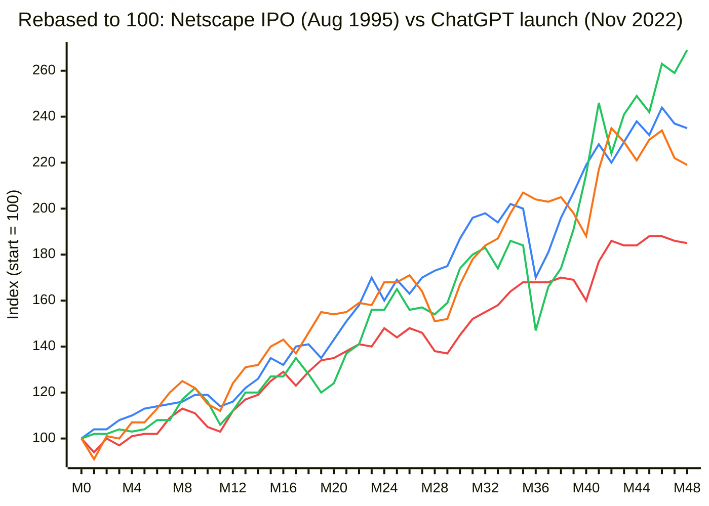
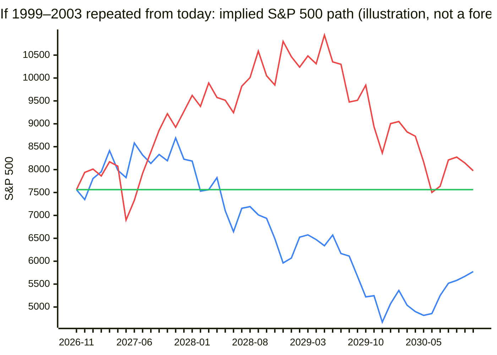
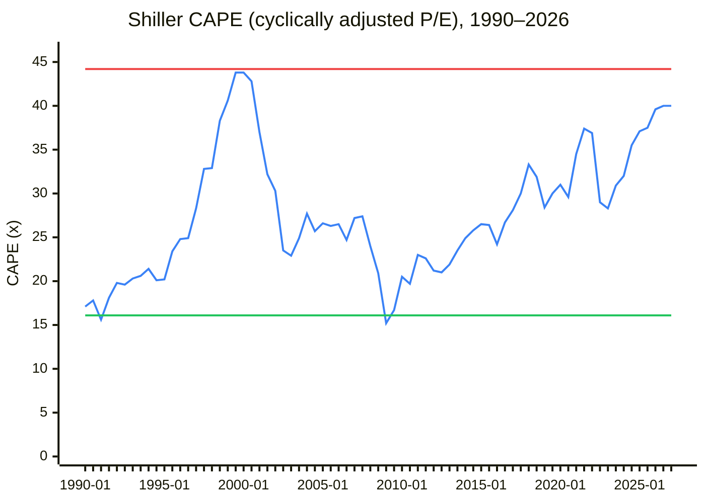
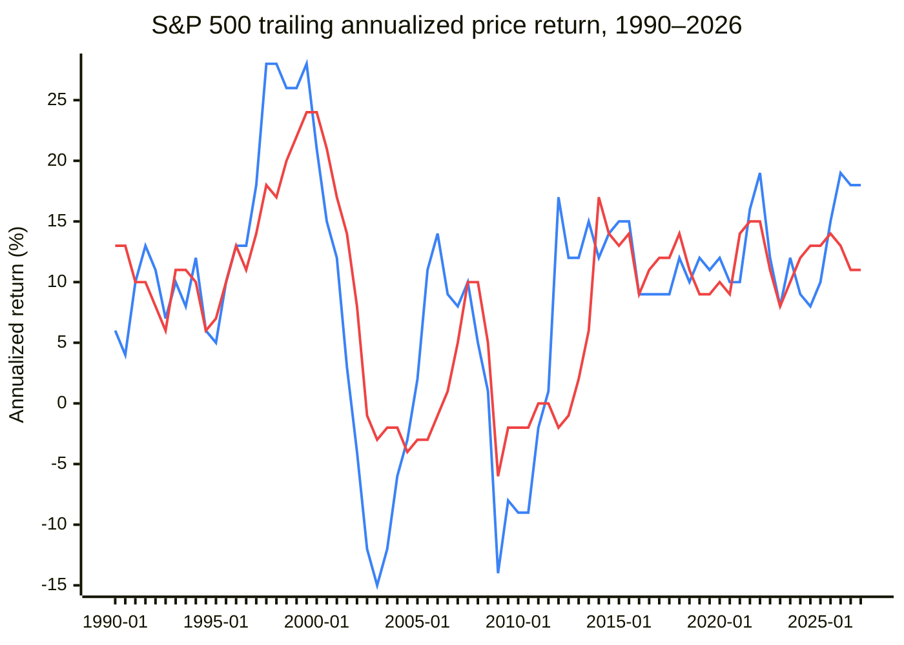
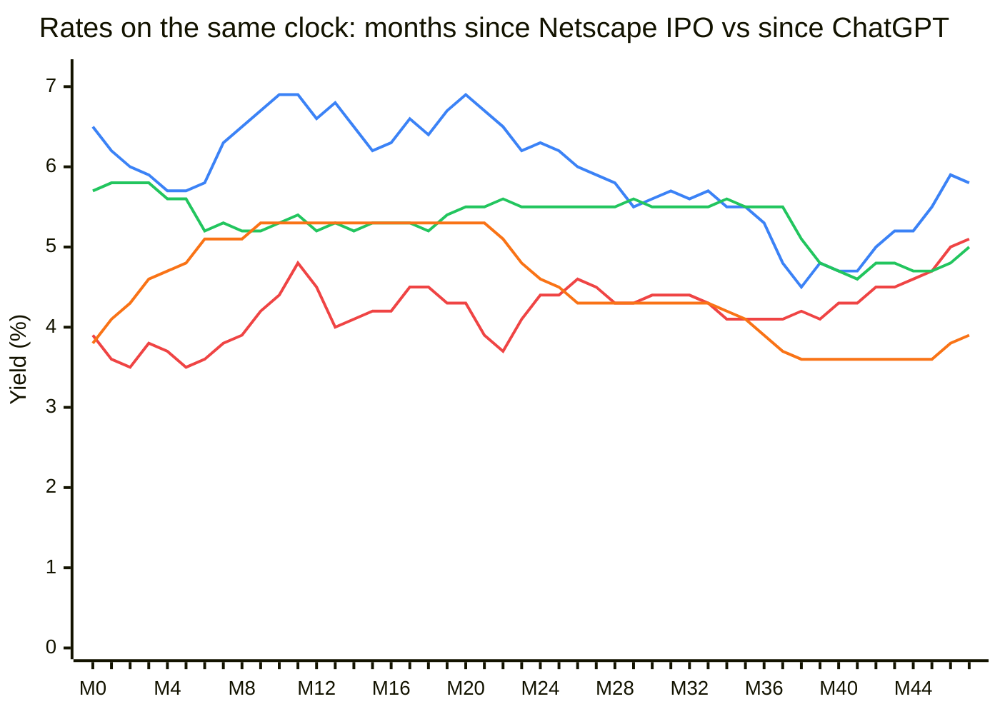

# Is the S&P 500 replaying 1999? A chart-matched look at the dot-com analog

*Research for [issue #61](https://github.com/cv/pinance/issues/61). Data through 13 Nov 2026 (monthly closes; November 2026 is month-to-date). Raw series: [`data/dotcom-analog-monthly.csv`](data/dotcom-analog-monthly.csv).*

## Summary

The overlay looks convincing, but most of the match comes from both lines rising. The two runs share a direction, not a rhythm.

- **Same clock, smaller move.** Line up the Netscape IPO (Aug 1995) with ChatGPT's launch (Nov 2022) and today lands on **Aug 1999**, seven months before the Nasdaq top. Over those 48 months the S&P 500 rose **+85%**, against **+135%** in 1995–99. The Nasdaq rose **+119%**, against **+169%**.
- **The fit is weak.** The rebased levels correlate at 0.97, but any two rising lines do. Month-to-month returns correlate at **−0.10**, which is no relationship at all. Across every 49-month window from 1987 to 2002, the best return correlation is only 0.37.
- **By size of gain, today looks like early 1998, not late 1999.** The 1990s window that best matches the current path starts in Feb 1994. That puts "today" at **Feb 1998**, about 25 months before the top, and before the steepest part of the bubble.
- **Valuation is close to 1999.** The Shiller CAPE is **39.95**, against a peak of 44.2 in Dec 1999. The last time it was this high was Jan 1999 (40.6). The long-run median is 16.2.
- **Momentum is far from 1999.** The S&P's trailing 5-year return is **10.6% a year**, against **24.3%** at the Jan 2000 peak. The trailing 3-year return is 18.3%, against 26.5% in Aug 1999.
- **Rates are the closest echo.** The 10-year Treasury yield rose from 4.14% (Dec 2025) to **5.13%** (Oct 2026). In 1999 it rose from 4.72% to 6.28% in a year while the Fed hiked. Effective fed funds has also turned up, from 3.63% to 3.88% since August.
- **There has been no blow-off.** In the last seven months of the bubble the Nasdaq rose 67% and the Nasdaq/S&P ratio jumped 47%. Nothing like that has happened yet. The Nasdaq peaked in May 2026 and is 6.8% below that peak, while the S&P is 1.2% below its September high.

## 1. The overlay

Series: 🟦 S&P 500, Aug 1995–Aug 1999, 🟥 S&P 500, Nov 2022–Nov 2026, 🟩 Nasdaq Composite, Aug 1995–Aug 1999, 🟧 Nasdaq Composite, Nov 2022–Nov 2026. Source: https://finance.yahoo.com/quote/%5EGSPC/history, https://finance.yahoo.com/quote/%5EIXIC/history

| 48 months from the starting gun | S&P 1995–99 | S&P 2022–26 | Nasdaq 1995–99 | Nasdaq 2022–26 |
|---|---:|---:|---:|---:|
| Total gain | +135% | +85% | +169% | +119% |
| Annualized | 23.8% | 16.7% | 28.0% | 21.7% |
| Volatility (monthly, annualized) | 15.2% | 12.6% | 22.8% | 17.6% |
| Max drawdown (monthly closes) | −15.6% | −8.6% | −20.9% | −11.9% |

The current run is about two-thirds the size of the 1990s run, with less volatility and shallower pullbacks. Monthly closes understate intramonth lows, such as April 2025.

## 2. Where on the 1990s timeline are we?

For every 49-month window of 1987–2002, I compared its rebased log path with Nov 2022–Nov 2026 (RMSE and correlation).

| Alignment | "Today" equals | Months to top | Then: further S&P upside | Then: S&P trough vs today |
|---|---|---:|---:|---:|
| Netscape ↔ ChatGPT (narrative) | Aug 1999 | 7 | +15% (Aug 2000 close) | −38% (Sep 2002) |
| Best fit by shape (start Feb 1994) | Feb 1998 | 25 | +45% | −22% |

The two alignments disagree by about 18 months on where we are. That spread is the most useful thing the analog tells you: it cannot time anything.

Series: 🟦 Netscape alignment (today = Aug 1999), 🟥 Best-fit alignment (today = Feb 1998), 🟩 S&P 500 today (7,562). Source: https://finance.yahoo.com/quote/%5EGSPC/history, https://finance.yahoo.com/quote/%5EIXIC/history

This chart replays the 1990s percentage moves from today's level. It is an illustration, not a forecast. Under the Netscape alignment the S&P reaches about 8,700 by late 2027 and then falls to about 4,700. Under the best-fit alignment it rises to about 10,900 first.

## 3. Valuation: the strongest parallel

Series: 🟦 S&P 500 CAPE, 🟥 Dot-com peak (44.2, Dec 1999), 🟩 Long-run median since 1871 (16.15). 75 of 149 points shown. Source: https://www.multpl.com/shiller-pe/table/by-month

- CAPE is 39.95, against 44.2 at the peak. It has been near 40 for most of 2026 (37.0–41.0).
- The CAPE earnings yield (1/CAPE) is 2.5%, against a 5.13% 10-year yield, a gap of −2.6 points. In Dec 1999 the gap was 2.3% against 6.28%, or −4.0 points. Equities are expensive relative to bonds, though not as expensive as at the peak.
- Leaders are priced differently. Trailing P/Es from the Financial Datasets snapshot: NVDA 19.6x, MSFT 27.2x, AAPL 39.2x, AMZN 20.9x, GOOGL 15.0x, META 21.4x, AVGO 42.5x. TSLA, at 416x, is the outlier. In March 2000 many leaders, such as Cisco, traded at well over 100x. Today's index multiple comes from very large, very profitable companies, not from unprofitable ones.

## 4. Momentum: the weakest parallel

Series: 🟦 Trailing 3-year, 🟥 Trailing 5-year. Source: https://finance.yahoo.com/quote/%5EGSPC/history

In 1999 the S&P had returned more than 20% a year for five years. Today the 5-year figure (10.6%) still includes the 2022 bear market, so it is closer to the long-run average than to a mania.

## 5. Rates on the same clock

Series: 🟦 10-yr Treasury, 1995–99, 🟥 10-yr Treasury, 2022–26, 🟩 Fed funds, 1995–99, 🟧 Fed funds, 2022–26. Source: https://fred.stlouisfed.org/graph/fredgraph.csv?id=GS10, https://fred.stlouisfed.org/graph/fredgraph.csv?id=FEDFUNDS

In 1999 a 150 bp rise in the 10-year yield and 175 bp of Fed hikes (Jun 1999–May 2000) came before the top. Today the 10-year is up about 100 bp in 10 months, and fed funds has stopped falling. This is the part of the analog to watch most closely.

## What would make the analog more convincing

1. **A blow-off.** The Nasdaq and the Nasdaq/S&P ratio would accelerate sharply, as in Sep 1999–Mar 2000.
2. **Rate pressure that continues.** The 10-year would stay above 5% and the Fed would hike.
3. **Weakening breadth or earnings.** The 2000 top came with narrow leadership, then earnings fell in 2001. Today's leaders have low P/Es because their earnings are high, so the risk to watch is an earnings or capex cycle turning. (Market-cap concentration was not measured here.)

## Method and sources

- S&P 500 (^GSPC) and Nasdaq Composite (^IXIC) monthly closes from Yahoo Finance. Financial Datasets and Equibles price history only goes back to 2020–2023.
- CAPE from [multpl.com](https://www.multpl.com/shiller-pe/table/by-month) (Shiller data).
- Fed funds ([FEDFUNDS](https://fred.stlouisfed.org/series/FEDFUNDS)) and 10-year Treasury ([GS10](https://fred.stlouisfed.org/series/GS10)) from FRED.
- Leader P/Es from `https://api.financialdatasets.ai/financial-metrics/snapshot/?ticker=…`.
- Fit: RMSE and Pearson correlation of rebased log price paths, plus correlation of monthly log returns, over 49-month windows starting 1987-01 through 1998-12.
- These are price returns only, without dividends. Analog studies are prone to data mining, and this note should not be read as a forecast.
