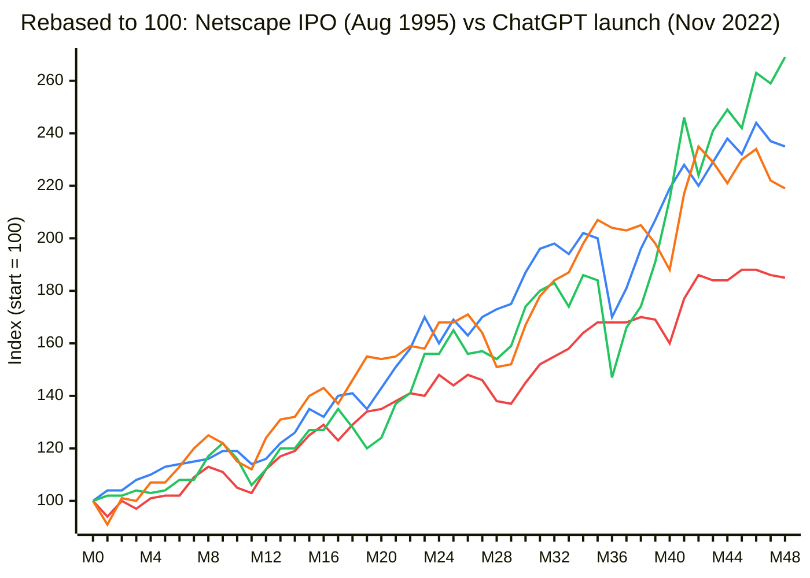
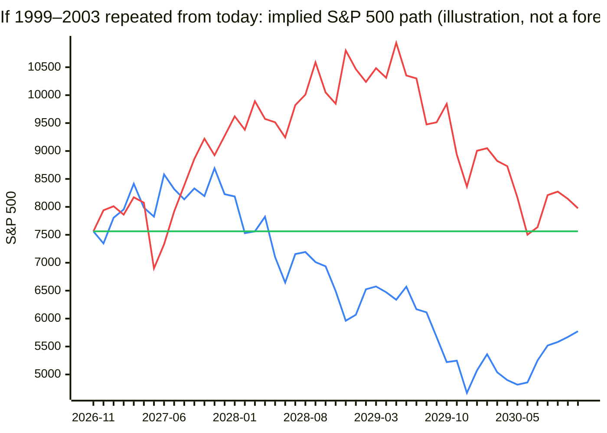
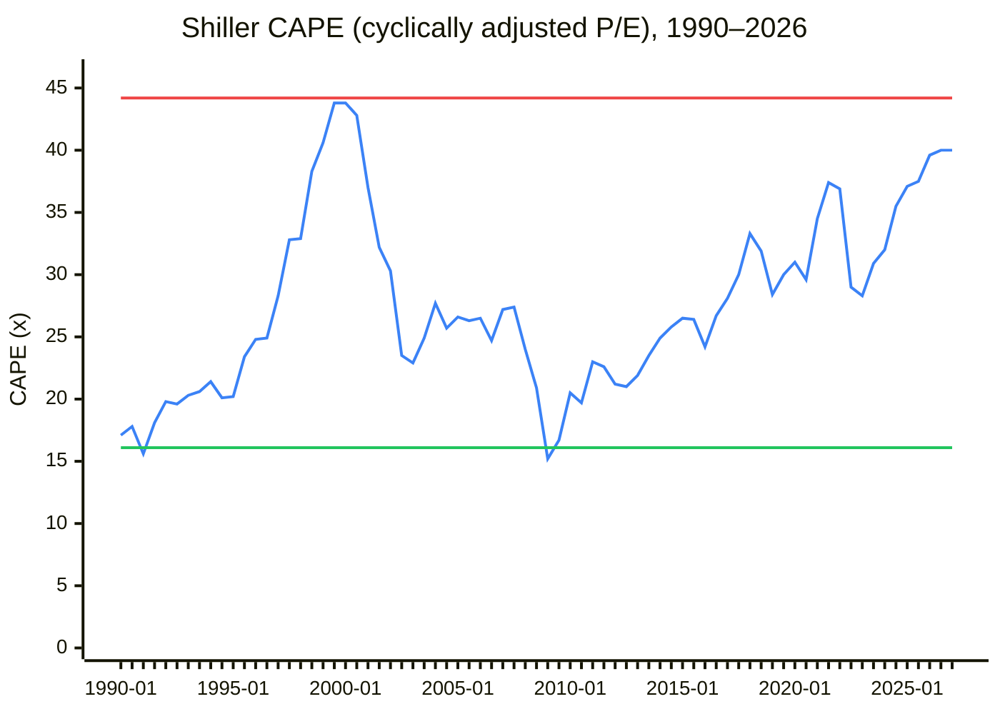
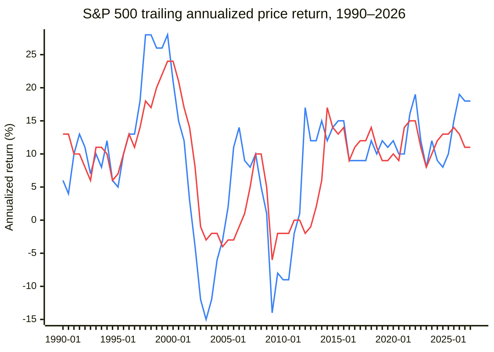
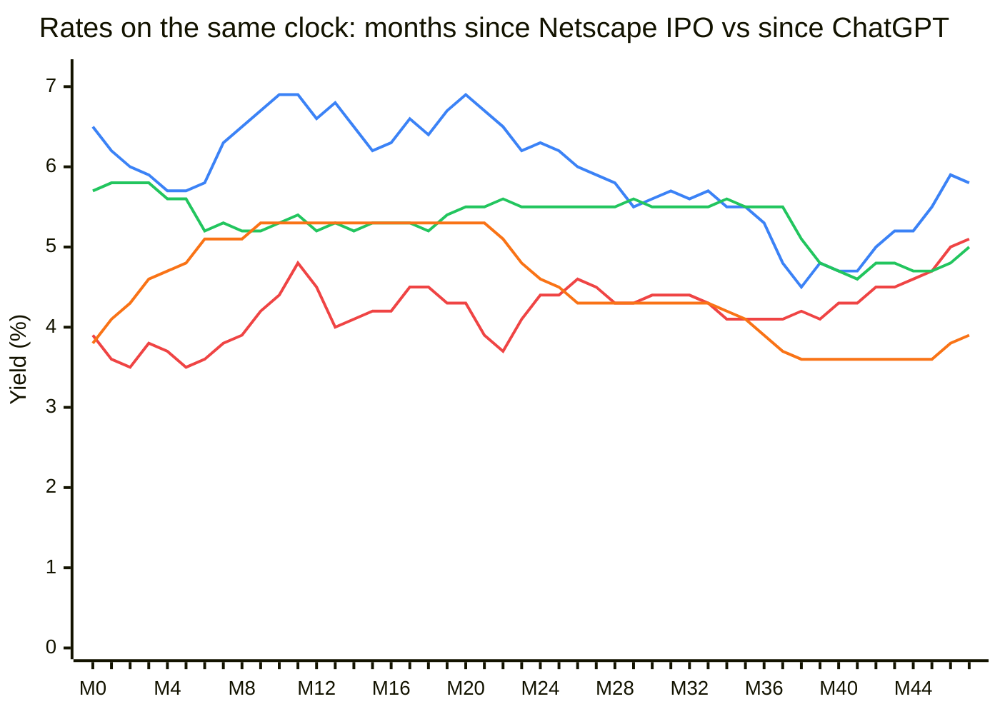
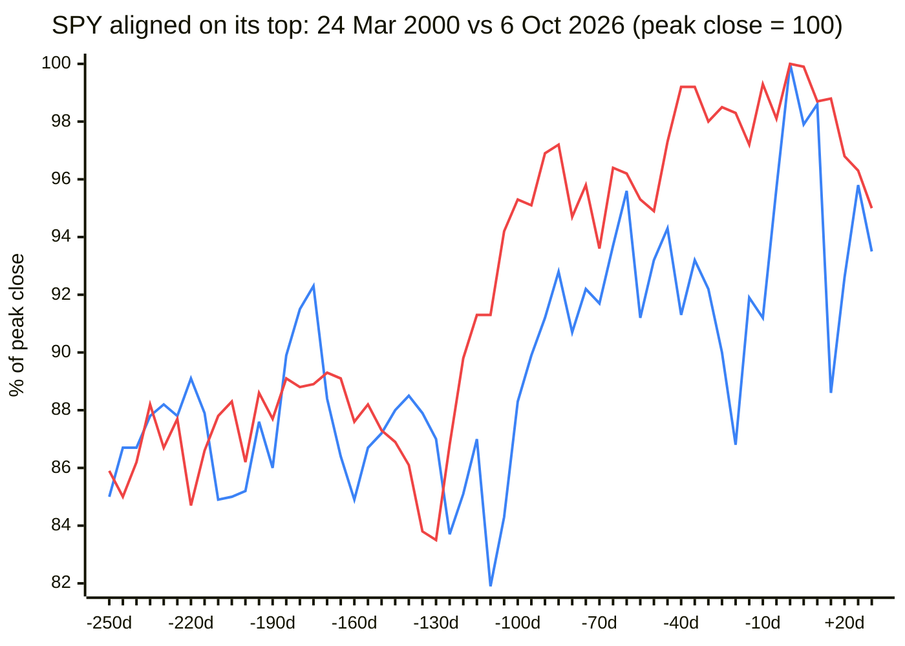
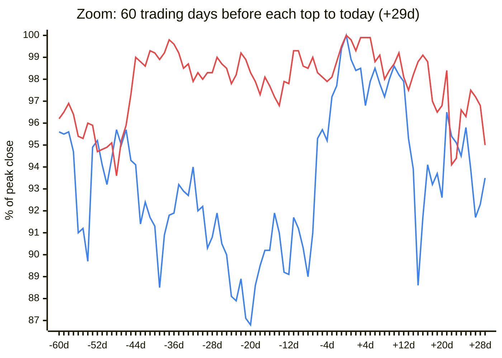
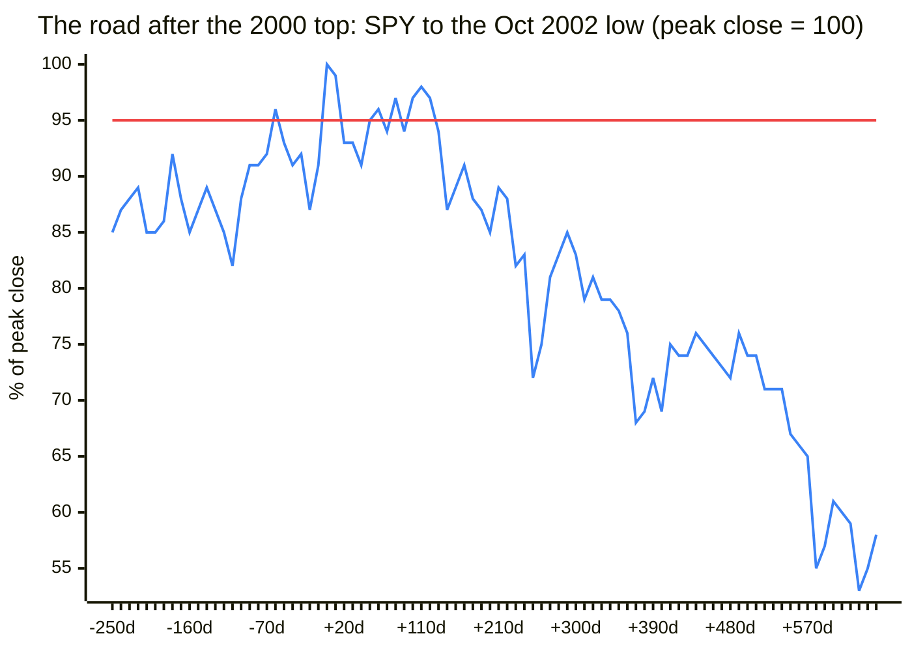
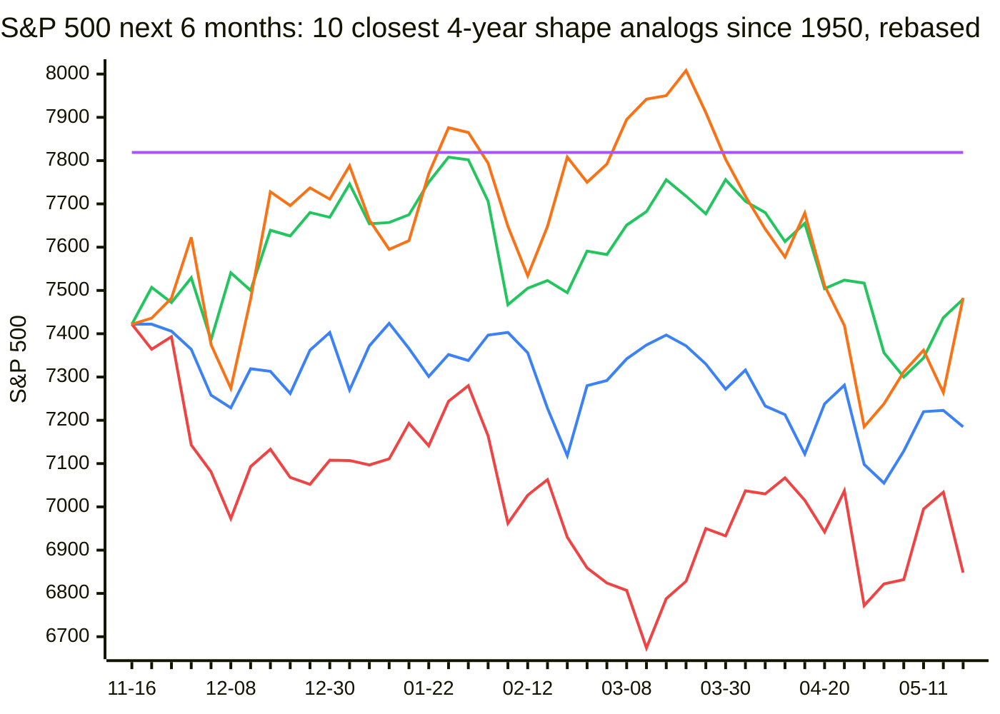
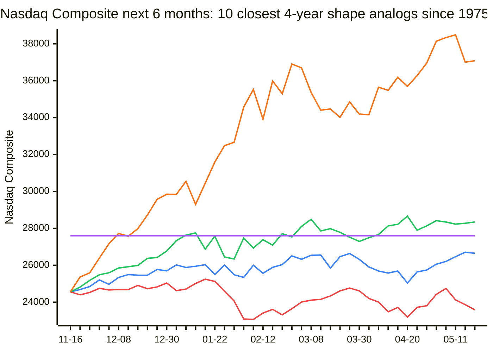

# Is the S&P 500 replaying 1999? A chart-matched look at the dot-com analog

*Research for [issue #61](https://github.com/cv/pinance/issues/61). Data through 13 Nov 2026 (monthly closes; November 2026 is month-to-date). Raw series: [`data/dotcom-analog-monthly.csv`](data/dotcom-analog-monthly.csv).*

## Summary

The overlay looks convincing, but most of the match comes from both lines rising. The two runs share a direction, not a rhythm.

- **Same clock, smaller move.** Line up the Netscape IPO (Aug 1995) with ChatGPT's launch (Nov 2022) and today lands on **Aug 1999**, seven months before the Nasdaq top. Over those 48 months the S&P 500 rose **+85%**, against **+135%** in 1995–99. The Nasdaq rose **+119%**, against **+169%**.
- **The fit is weak.** The rebased levels correlate at 0.97, but any two rising lines do. Month-to-month returns correlate at **−0.10**, which is no relationship at all. Across every 49-month window from 1987 to 2002, the best return correlation is only 0.37.
- **By size of gain, today looks like early 1998, not late 1999.** The 1990s window that best matches the current path starts in Feb 1994. That puts "today" at **Feb 1998**, about 25 months before the top, and before the steepest part of the bubble.
- **Valuation is close to 1999.** The Shiller CAPE is **39.95**, against a peak of 44.2 in Dec 1999. The last time it was this high was Jan 1999 (40.6). The long-run median is 16.2.
- **Momentum is far from 1999.** The S&P's trailing 5-year return is **10.6% a year**, against **24.3%** at the Jan 2000 peak. The trailing 3-year return is 18.3%, against 26.5% in Aug 1999.
- **Rates are the closest echo.** The 10-year Treasury yield rose from 4.14% (Dec 2025) to **5.13%** (Oct 2026). In 1999 it rose from 4.72% to 6.28% in a year while the Fed hiked. Effective fed funds has also turned up, from 3.63% to 3.88% since August.
- **There has been no blow-off.** In the last seven months of the bubble the Nasdaq rose 67% and the Nasdaq/S&P ratio jumped 47%. Nothing like that has happened yet. On monthly closes the Nasdaq Composite's high was May 2026 and the S&P's was September 2026. On daily closes both peaked on 6 Oct 2026 (see section 6), so tech did not top first.

## 1. The overlay

Series: 🟦 S&P 500, Aug 1995–Aug 1999, 🟥 S&P 500, Nov 2022–Nov 2026, 🟩 Nasdaq Composite, Aug 1995–Aug 1999, 🟧 Nasdaq Composite, Nov 2022–Nov 2026. Source: https://finance.yahoo.com/quote/%5EGSPC/history, https://finance.yahoo.com/quote/%5EIXIC/history

| 48 months from the starting gun | S&P 1995–99 | S&P 2022–26 | Nasdaq 1995–99 | Nasdaq 2022–26 |
|---|---:|---:|---:|---:|
| Total gain | +135% | +85% | +169% | +119% |
| Annualized | 23.8% | 16.7% | 28.0% | 21.7% |
| Volatility (monthly, annualized) | 15.2% | 12.6% | 22.8% | 17.6% |
| Max drawdown (monthly closes) | −15.6% | −8.6% | −20.9% | −11.9% |

The current run is about two-thirds the size of the 1990s run, with less volatility and shallower pullbacks. Monthly closes understate intramonth lows, such as April 2025.

## 2. Where on the 1990s timeline are we?

For every 49-month window of 1987–2002, I compared its rebased log path with Nov 2022–Nov 2026 (RMSE and correlation).

| Alignment | "Today" equals | Months to top | Then: further S&P upside | Then: S&P trough vs today |
|---|---|---:|---:|---:|
| Netscape ↔ ChatGPT (narrative) | Aug 1999 | 7 | +15% (Aug 2000 close) | −38% (Sep 2002) |
| Best fit by shape (start Feb 1994) | Feb 1998 | 25 | +45% | −22% |

The two alignments disagree by about 18 months on where we are. That spread is the most useful thing the analog tells you: it cannot time anything.

Series: 🟦 Netscape alignment (today = Aug 1999), 🟥 Best-fit alignment (today = Feb 1998), 🟩 S&P 500 today (7,562). Source: https://finance.yahoo.com/quote/%5EGSPC/history, https://finance.yahoo.com/quote/%5EIXIC/history

This chart replays the 1990s percentage moves from today's level. It is an illustration, not a forecast. Under the Netscape alignment the S&P reaches about 8,700 by late 2027 and then falls to about 4,700. Under the best-fit alignment it rises to about 10,900 first.

## 3. Valuation: the strongest parallel

Series: 🟦 S&P 500 CAPE, 🟥 Dot-com peak (44.2, Dec 1999), 🟩 Long-run median since 1871 (16.15). 75 of 149 points shown. Source: https://www.multpl.com/shiller-pe/table/by-month

- CAPE is 39.95, against 44.2 at the peak. It has been near 40 for most of 2026 (37.0–41.0).
- The CAPE earnings yield (1/CAPE) is 2.5%, against a 5.13% 10-year yield, a gap of −2.6 points. In Dec 1999 the gap was 2.3% against 6.28%, or −4.0 points. Equities are expensive relative to bonds, though not as expensive as at the peak.
- Leaders are priced differently. Trailing P/Es from the Financial Datasets snapshot: NVDA 19.6x, MSFT 27.2x, AAPL 39.2x, AMZN 20.9x, GOOGL 15.0x, META 21.4x, AVGO 42.5x. TSLA, at 416x, is the outlier. In March 2000 many leaders, such as Cisco, traded at well over 100x. Today's index multiple comes from very large, very profitable companies, not from unprofitable ones.

## 4. Momentum: the weakest parallel

Series: 🟦 Trailing 3-year, 🟥 Trailing 5-year. Source: https://finance.yahoo.com/quote/%5EGSPC/history

In 1999 the S&P had returned more than 20% a year for five years. Today the 5-year figure (10.6%) still includes the 2022 bear market, so it is closer to the long-run average than to a mania.

## 5. Rates on the same clock

Series: 🟦 10-yr Treasury, 1995–99, 🟥 10-yr Treasury, 2022–26, 🟩 Fed funds, 1995–99, 🟧 Fed funds, 2022–26. Source: https://fred.stlouisfed.org/graph/fredgraph.csv?id=GS10, https://fred.stlouisfed.org/graph/fredgraph.csv?id=FEDFUNDS

In 1999 a 150 bp rise in the 10-year yield and 175 bp of Fed hikes (Jun 1999–May 2000) came before the top. Today the 10-year is up about 100 bp in 10 months, and fed funds has stopped falling. This is the part of the analog to watch most closely.

## What would make the analog more convincing

1. **A blow-off.** The Nasdaq and the Nasdaq/S&P ratio would accelerate sharply, as in Sep 1999–Mar 2000.
2. **Rate pressure that continues.** The 10-year would stay above 5% and the Fed would hike.
3. **Weakening breadth or earnings.** The 2000 top came with narrow leadership, then earnings fell in 2001. Today's leaders have low P/Es because their earnings are high, so the risk to watch is an earnings or capex cycle turning. (Market-cap concentration was not measured here.)

## 6. Peak-aligned: SPY's 2026 top vs the 24 Mar 2000 top

*Added after [this comment](https://github.com/cv/pinance/issues/61#issuecomment-6926871851). Daily SPY closes; offsets are trading days from each top. Data: [`data/spy-peak-aligned-daily.csv`](data/spy-peak-aligned-daily.csv).*

SPY's 2026 closing high so far was **$779.09 on 6 Oct 2026**, a figure Financial Datasets also confirms. On 16 Nov SPY was at $739.86, **5.0% below** that high. The dot-com top in SPY was **$153.56 on 24 Mar 2000**, the same day as the S&P 500's closing high of 1,527.46.

Series: 🟦 SPY around the 24 Mar 2000 top, 🟥 SPY around the 6 Oct 2026 top. Source: https://finance.yahoo.com/quote/SPY/history, https://api.financialdatasets.ai/prices/?ticker=SPY&start_date=2026-09-01&end_date=2026-11-16&interval=day&interval_multiplier=1

Series: 🟦 SPY 2000, 🟥 SPY 2026. Source: https://finance.yahoo.com/quote/SPY/history, https://api.financialdatasets.ai/prices/?ticker=SPY&start_date=2026-09-01&end_date=2026-11-16&interval=day&interval_multiplier=1

| | 2000 top | 2026 top |
|---|---:|---:|
| Gain in the 250 trading days before the top | +17.7% | +16.4% |
| Gain in the 500 trading days before the top | +38.6% | +37.2% |
| Change 29 trading days after the top | −6.5% (5 May 2000) | −5.0% (16 Nov 2026) |
| Worst close in those 29 days | −11.4% | −5.9% (5 Nov) |

Series: 🟦 SPY 1999–2002, 🟥 SPY today vs its 6 Oct 2026 top (-5%). 90 of 91 points shown. Source: https://finance.yahoo.com/quote/SPY/history

**What happened after the 2000 top:**

- SPY fell 10% within 15 trading days (14 Apr 2000).
- It then recovered to within 0.7% of the high by 1 Sep 2000.
- It did not close 20% below the high until 12 Mar 2001, almost a year later.
- The low came on 9 Oct 2002, 49.1% below the high and 637 trading days after the top.

**How to read it:**

- The run-ups into the two tops are almost the same size: about +17% over one year and about +38% over two.
- The first weeks after each top are also similar.
- The 2000 top was only confirmed in hindsight, after more than six months that included a near-retest. 6 Oct is a top only if SPY does not make a new high, so this alignment assumes the top is already in.

## 7. Review of the "2000 vs 2026 Market Overlay" page

*Reviewing [this attachment](https://github.com/user-attachments/files/34935078/2000.vs.2026.Market.Overlay.html), posted in [this comment](https://github.com/cv/pinance/issues/61#issuecomment-6927194130).*

**The data is accurate.** The page's embedded daily series match Yahoo's ^GSPC and ^NDX closes, for example 1,527.46 on 24 Mar 2000, 7,818.93 on 6 Oct 2026, and 4,704.73 for the Nasdaq-100 on 27 Mar 2000. Only the last point differs, because it is intraday. Recomputing from the page's own data reproduces its table: −6.2% and −5.2% for the S&P 29 sessions after each peak, 11.3% vs 8.1% above the 200-day average, 63-day volatility of about 24% vs 11%, and the Nasdaq-100 at −25.1% vs −12.8%.

**Small fixes:**

- 29 sessions after 24 Mar 2000 is **5 May 2000**, not 4 May. On 4 May the S&P was −7.7%.
- For the Nasdaq-100, 29 sessions after its 27 Mar 2000 peak is 8 May.

**The best fit holds up, with a caveat.** I compared the last 1,008 sessions with every 4-year window since 1950, sampled weekly. That is 3,464 windows. The window ending in early May 2000 (correlation 0.985) is the best of all of them, and only 6% of windows reach 0.95. So the shape match is unusual, not something any rising market produces. The caveat is the day-to-day moves: daily returns in the two windows correlate at about 0.03. What matches is the overall arc (a dip, a long rally, a rollover), not the daily path.

**What followed the other close matches:**

| Window ending | Shape correlation | S&P over the next 12 months | Worst point in those 12 months |
|---|---:|---:|---:|
| 4 May 2000 | 0.985 | −10.1% | −21.7% |
| 7 Jul 1999 | 0.976 | +3.6% | −10.6% |
| 11 Aug 2015 | 0.971 | +4.4% | −12.2% |
| 28 Apr 1966 | 0.955 | +3.2% | −19.7% |
| 21 Jan 1957 | 0.951 | −7.0% | −12.2% |
| 8 Jan 2020 | 0.947 | +16.9% | −31.2% |

The arc it matches is a long rally that rolls over. In this set, that has been followed by a pullback of at least 10% within a year, but only 2000 became a long bear market. The 1987 match (correlation 0.93) ended on the crash day itself, so it is left out.

**What the page leaves out:** its own table makes the case that the S&P has the 2000 shape but not its intensity. The 3-month volatility is less than half of 2000's, the distance above the 200-day average is lower, and the gain from the cycle low is about half. Those measure how stretched a market is.

## 8. What the correlations imply for the next few months

*Added after [this comment](https://github.com/cv/pinance/issues/61#issuecomment-6927419254). Starting point: close of 16 Nov 2026, S&P 500 at 7,422 and Nasdaq Composite at 24,562. Analogs are the 10 closest 4-year (1,008-session) shape matches, taken from separate episodes at least 250 sessions apart and ending before Nov 2022. Each index was searched against its own history: the S&P since 1950, the Nasdaq Composite since 1971.*

Series: 🟦 Analog median, 🟥 Analog 25th percentile, 🟩 Analog 75th percentile, 🟧 Best match: S&P after 4 May 2000, 🟪 6 Oct 2026 closing high (7,819). Source: https://finance.yahoo.com/quote/%5EGSPC/history

Series: 🟦 Analog median, 🟥 Analog 25th percentile, 🟩 Analog 75th percentile, 🟧 Best match: Nasdaq after 19 Oct 1998, 🟪 6 Oct 2026 closing high (27,600). Source: https://finance.yahoo.com/quote/%5EIXIC/history

| Next 6 months | S&P: shape analogs | S&P: any 4–7% pullback | S&P: all periods | Nasdaq: shape analogs | Nasdaq: any 4–7% pullback | Nasdaq: all periods |
|---|---:|---:|---:|---:|---:|---:|
| Median 3-month return | −2.6% | +4.8% | +2.7% | +5.4% | +3.6% | +3.6% |
| Median 6-month return | −3.1% | +6.5% | +5.2% | +8.5% | +10.5% | +7.0% |
| Share higher after 6 months | 40% | 75% | 71% | 60% | 76% | 70% |
| Median worst drop within 6 months | −7.4% | −2.9% | | −4.1% | −7.3% | |
| Sample | 10 | 73 | 19,215 days | 10 | 41 | 13,937 days |

"Any 4–7% pullback" means every time since 1950 (S&P) or 1971 (Nasdaq) the index was 4–7% below a high set 15–45 sessions earlier, as now. Episodes are at least 60 sessions apart.

**S&P shape analogs:** 2000-05-04, 1998-02-27, 2015-08-11, 1999-05-07, 1966-04-28, 2019-12-03, 1957-01-23, 2007-05-24, 1994-01-10, 1987-10-16. 3 of 10 fell more than 17% within six months (1966, 2019 into the Covid crash, 1987).

**Nasdaq shape analogs:** 1998-10-19 (+51% in six months), 2015-12-14, 1979-08-06, 2020-07-08, 1981-11-13, 1980-08-01, 2000-05-19, 2013-07-12, 1994-07-13, 1978-08-07.

**How to read it:**

1. **Even replaying 2000 exactly is mild over the next six months.** After 4 May 2000 the S&P was +3.0% at three months and +0.8% at six, with a worst point of −5.7%. The serious losses came 6–30 months later.
2. **The two indices point to different years.** The S&P's best match is just after the 2000 top; the Nasdaq's is October 1998, just before the final blow-off. They cannot both repeat, because in 1998–2000 the two moved together. That disagreement is a reason to treat any single analog with caution.
3. **The S&P analogs lean flat to lower over six months, while ordinary pullbacks usually recover.** The truth is likely between the two, with a wider range than usual: roughly 6,850–7,500 for the S&P's middle half (25th to 75th percentile) at six months, and roughly 23,600–28,300 for the Nasdaq.
4. **Downside levels to watch:**
   - **S&P −10% from its high, about 7,040.** In 2000 the first pullback bottomed at −11%. Ordinary pullbacks rarely go much past it.
   - **S&P −20%, about 6,255.** That would be a bear market, which in 2000 took almost a year to arrive.

This is a historical comparison with very small samples, not a forecast or investment advice.

## Method and sources

- S&P 500 (^GSPC) and Nasdaq Composite (^IXIC) monthly closes from Yahoo Finance. Financial Datasets and Equibles price history only goes back to 2020–2023.
- CAPE from [multpl.com](https://www.multpl.com/shiller-pe/table/by-month) (Shiller data).
- Fed funds ([FEDFUNDS](https://fred.stlouisfed.org/series/FEDFUNDS)) and 10-year Treasury ([GS10](https://fred.stlouisfed.org/series/GS10)) from FRED.
- Leader P/Es from `https://api.financialdatasets.ai/financial-metrics/snapshot/?ticker=…`.
- Fit: RMSE and Pearson correlation of rebased log price paths, plus correlation of monthly log returns, over 49-month windows starting 1987-01 through 1998-12.
- These are price returns only, without dividends. Analog studies are prone to data mining, and this note should not be read as a forecast.
